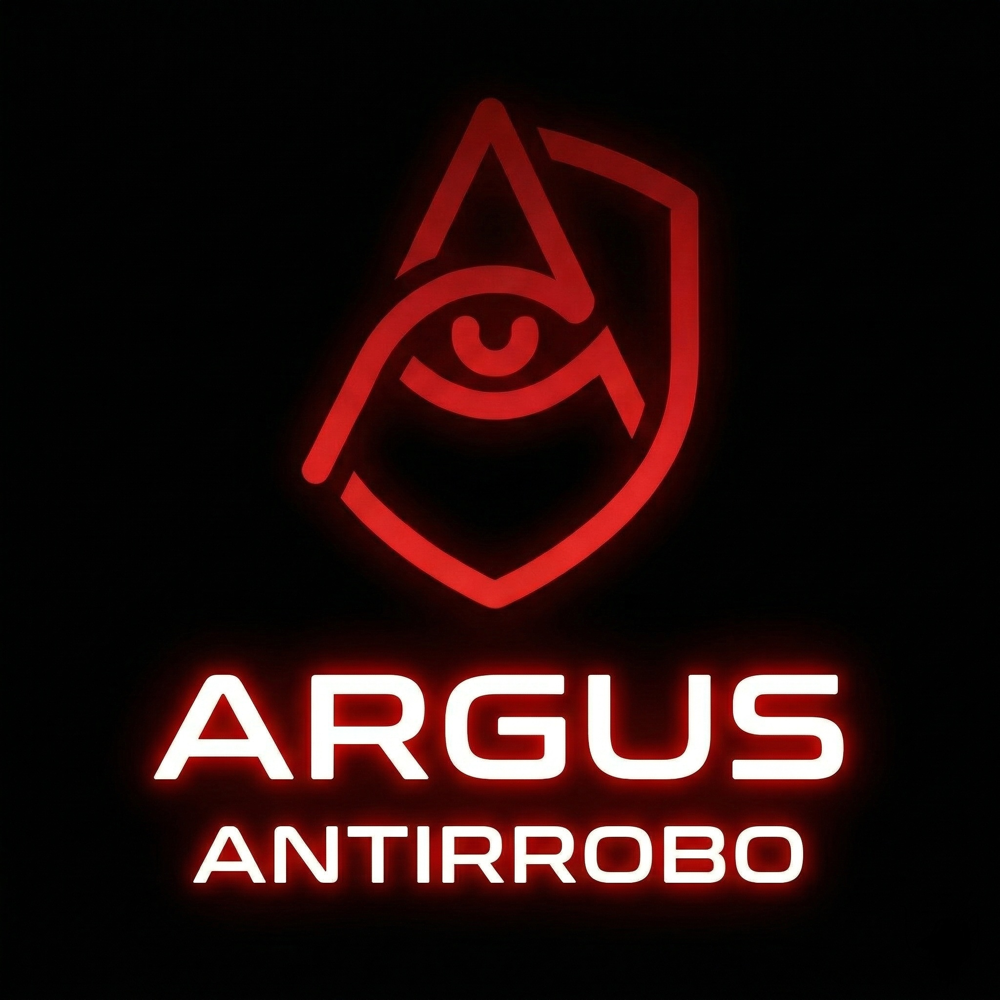
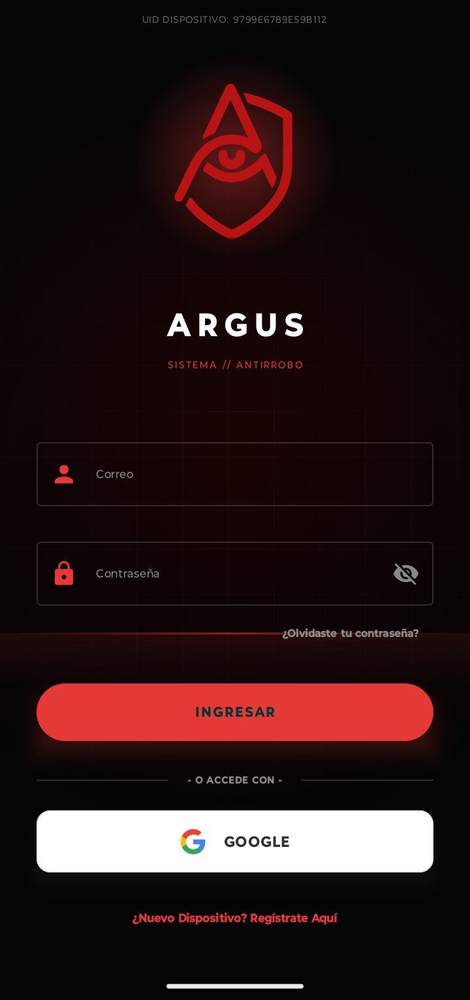
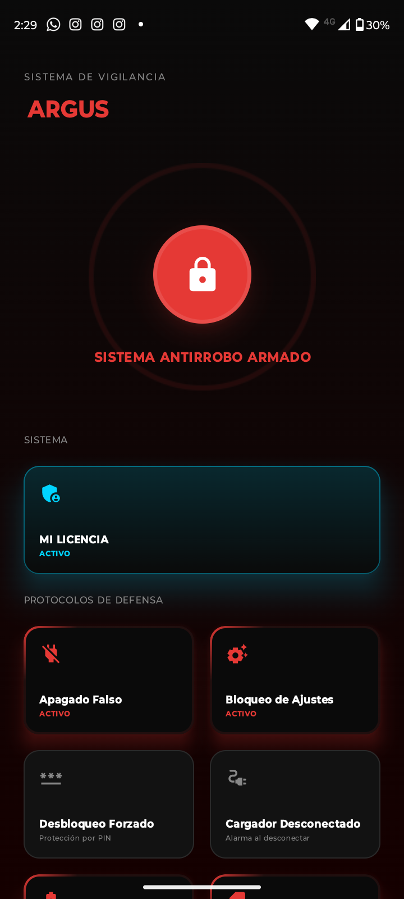
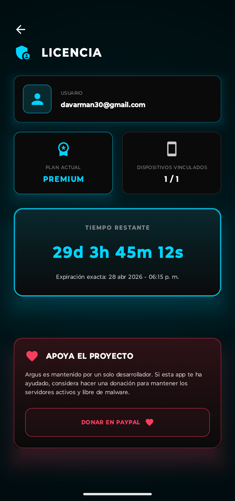
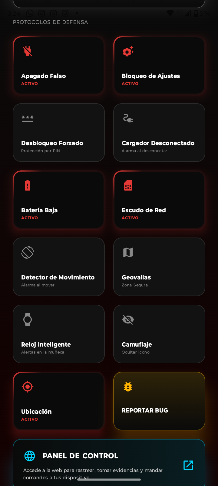
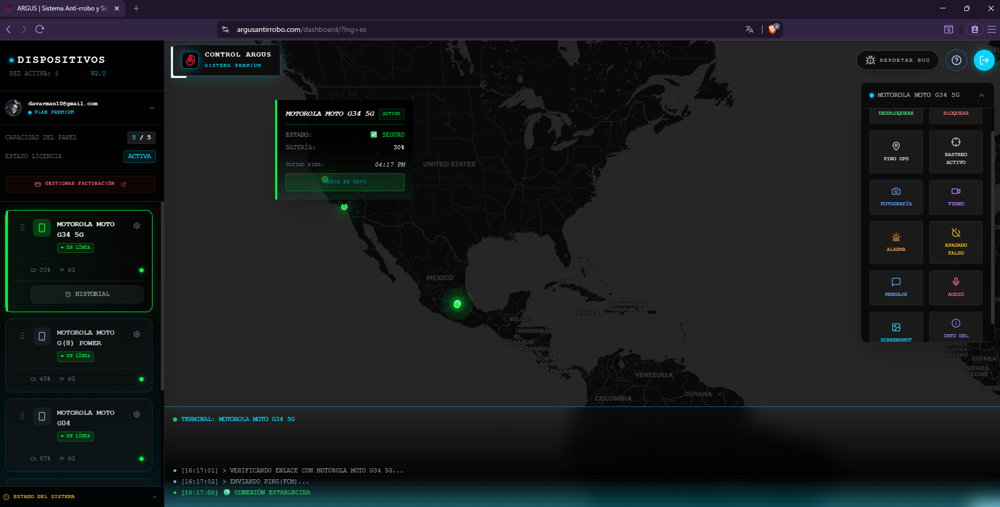

    

# `>_` Argus Anti-rrobo (Security System)

**Plataforma de Seguridad Integral, Defensiva y Táctica para Android. Rastreo, telemetría y contramedidas activas.**

### 🌐 [www.argusantirrobo.com](https://www.argusantirrobo.com)

 

| 🛡️ | **Estado** | **Descripción y Novedades** |
| :---: | :--- | :--- |
| **v3.5** | 🚀 **Estable** | *Suite de Seguridad Activa: Cliente Android (El Escudo) + [Panel Web Oficial](https://www.argusantirrobo.com).*   **¡Descarga el APK oficial abajo!**    

<strong>✨ Clic para ver Novedades v3.5 (Build 19)</strong>
 Esta actualización incluye el nuevo núcleo de sincronización reactiva en tiempo real y defensa reforzada:  <b>🛡️ Novedades Principales</b><ul><li><b>Sincronización Instantánea de Licencias:</b> Detección sub-segundo de renovaciones y expiraciones vía Firestore gRPC en vivo y Ping FCM silencioso.</li><li><b>Expiración Exacta al Milisegundo:</b> Temporizador de alta precisión que bloquea la terminal e informa en el segundo exacto que vence la suscripción.</li><li><b>Notificación Frontal Mutable Unificada (ID 1001):</b> Transición instantánea entre Escudo Protegido, Alerta Heads-Up de Permisos Revocados y Notificación Prioritaria de Actualización OTA.</li><li><b>Centinela de Permisos Continuo (12s):</b> Auditoría en segundo plano que detecta qué permiso fue revocado y avisa al instante con acción rápida de restauración.</li><li><b>Blindaje Criptográfico HMAC-SHA256:</b> Licencia protegida a nivel hardware contra herramientas de manipulación de memoria (GameGuardian, editores de SharedPreferences).</li><li><b>Internacionalización Completa:</b> Soporte bilingüe integral (Español / Inglés) tanto en la aplicación móvil como en el Centro de Mando Web.</li></ul>
 |

 

---

    
Desplegar Tabla de Contenidos

    
 
        
- [`>_` Argus Anti-rrobo (Security System)](#_-argus-anti-rrobo-security-system)
  - [`>_` Propósito](#_-propósito)
  - [`>_` 📱 Galería de Pantallas](#_--galería-de-pantallas)
  - [`>_` ⬇️ Descarga Oficial](#_-️-descarga-oficial)
  - [`>_` Características](#_-características)
    - [El Arsenal (Comandos Web Remotos)](#el-arsenal-comandos-web-remotos)
    - [Los Centinelas (Seguridad Automática)](#los-centinelas-seguridad-automática)
  - [`>_` Arquitectura y Seguridad](#_-arquitectura-y-seguridad)
  - [`>_` Instalación](#_-instalación)
  - [`>_` 📺 Tutorial de Instalación y Configuración](#_--tutorial-de-instalación-y-configuración)
  - [`>_` ❓ Solución de Problemas (FAQ)](#_--solución-de-problemas-faq)
  - [`>_` Reporte de Vulnerabilidades](#_-reporte-de-vulnerabilidades)
  - [`>_` 🙌 Créditos y Desarrollador](#_--créditos-y-desarrollador)
    - [`>_` ⚖️ Aviso Legal (Disclaimer)](#_-️-aviso-legal-disclaimer)

---

## `>_` Propósito

Argus no es solo un rastreador GPS; es un **Sistema de Defensa Táctica**. Desarrollado con el objetivo de proporcionar recuperación real y protección de datos, la plataforma se divide en un cliente de bajo nivel que blinda el dispositivo (impidiendo accesos no autorizados) y un Panel de Control Web que permite reaccionar ante una emergencia.

**Casos de Uso Principales:**
- **Recuperación de Dispositivos:** Rastreo continuo y toma de evidencia (foto, video, audio) del perpetrador.
- **Protección de Datos:** Bloqueo físico del equipo y prevención de apagado para evitar que desactiven la conexión.
- **Disuasión Inmediata:** Detonación de alarmas a máximo volumen y flashes estroboscópicos ignorando el modo silencio.

> [!Caution]
> **Aviso de Permisos Sensibles:**  
> Para funcionar como un escudo real, Argus requiere privilegios profundos del sistema (Administrador de Dispositivos, Accesibilidad, Superposición). Sistemas como **Google Play Protect** pueden alertar sobre estos permisos. **Esto es normal**. Son las "armas" que Argus necesita para protegerte.

---

## `>_` 📱 Galería de Pantallas

Explora la interfaz móvil y el centro de mando:

     
    <table>
        <tr>
            <td align="center" width="50%">
                <strong>Acceso Seguro (Login)</strong> 
                
            </td>
            <td align="center" width="50%">
                <strong>Dashboard Móvil (El Escudo)</strong> 
                
            </td>
        </tr>
        <tr>
            <td align="center" width="50%">
                <strong>Gestión de Licencia</strong> 
                
            </td>
            <td align="center" width="50%">
                <strong>Configuración de Centinelas</strong> 
                
            </td>
        </tr>
        <tr>
            <td align="center" colspan="2">
                <strong>Arsenal Web (Centro de Mando)</strong> 
                
            </td>
        </tr>
    </table>
     

---

## `>_` ⬇️ Descarga Oficial

Este repositorio es el canal oficial de distribución. Descarga el archivo `Argus.apk` directamente desde la sección de **Releases** o desde nuestro portal web:

  

---

## `>_` Características

Argus opera en dos frentes simultáneos para garantizar la seguridad:

### El Arsenal (Comandos Web Remotos)
Accede a tu panel desde cualquier PC o celular y ejecuta:
- **📍 Rastreo Activo y Ping:** Coordenadas en tiempo real y verificación de conectividad con latencia cero.
- **📸 Intercepción Multimedia:** Toma fotos frontales/traseras, ráfagas de video o graba audio ambiental de forma 100% silenciosa.
- **🚨 Modo Pánico:** Alarma y flash a máxima potencia, anulando el modo "No Molestar".
- **💀 Falso Apagado Remoto:** Finge que el dispositivo se apaga para que el intruso deje de intentar vulnerarlo mientras sigue transmitiendo.
- **💬 Mensaje Persistente:** Proyecta un texto en pantalla que el intruso no puede cerrar.
- **🔄 Sincronización Remota de Licencia:** Actualización y reactivación instantánea de credenciales sin tocar el dispositivo.

### Los Centinelas (Seguridad Automática)
Vigilan tu dispositivo 24/7 sin necesitar comandos:
- **Tácticas Anti-Apagado:** Intercepta el menú de encendido y previene apagado no autorizado.
- **Desbloqueo Forzado:** Toma evidencia automática tras intentos fallidos de PIN/patrón.
- **Centinela de Permisos Activo:** Detecta la revocación de cualquier permiso crítico y emite alertas prioritarias.
- **Sensores de Perímetro:** Detonan la alarma si se **desconecta el cargador**, si **extraen la SIM**, o si se detecta **movimiento brusco**.
- **Protocolo Batería Crítica:** Envía ubicación y evidencia automática antes de agotarse la batería.

---

## `>_` Arquitectura y Seguridad

Este ecosistema ha sido diseñado bajo estrictos estándares de la industria:

| Componente | Descripción |
| :--- | :--- |
| **Criptografía** | AES-256 (en reposo), HMAC-SHA256 con sal por hardware y túneles TLS 1.2/1.3. |
| **Arquitectura** | Cliente Android nativo de bajo nivel (Kotlin Coroutines + Jetpack Compose) + Panel Web React. |
| **Autenticación** | Validada criptográficamente vía Google Auth y Firebase App Check. Pagos seguros vía Stripe (PCI-DSS Nivel 1). |
| **Anti-Tampering** | Integridad verificada criptográficamente para prevenir manipulación con GameGuardian, clonadores o acceso root. |

---

## `>_` Instalación

1. **Ajuste de Play Protect:** En Google Play Store > Perfil > Play Protect > Configuración, desactiva temporalmente el análisis. *(Requerido debido a la integración profunda en el núcleo del sistema).*
2. **Descarga:** Obtén el archivo `Argus.apk` desde los *Releases* de este repositorio o desde `argusantirrobo.com`.
3. **Permisos Críticos:** Al abrir la app, deberás conceder privilegios de *Administrador de Dispositivos* y *Accesibilidad*. Sigue las instrucciones en pantalla para el "Ajuste Restringido" si estás en Android 13+.
4. **Verificación:** Puedes reactivar Play Protect y realizar un escaneo. Google confirmará que Argus está instalado y seguro.
5. **Excepción de Batería:** Ve a los ajustes de tu teléfono y asegúrate de quitarle la "Optimización de Batería" a Argus para que el rastreo no se suspenda.

---

## `>_` 📺 Tutorial de Instalación y Configuración

¿Prefieres una guía visual? Mira el video oficial donde explicamos paso a paso cómo descargar el APK, configurar Play Protect y otorgar correctamente los permisos críticos (Accesibilidad, Administrador de Dispositivos, etc.) para que el blindaje de Argus funcione al 100%.

  
   
  <em>Clic en la imagen para reproducir el tutorial en YouTube</em>

---

## `>_` ❓ Solución de Problemas (FAQ)

**P: ¿Por qué mi aplicación de banco me pide cerrar Argus o desactivar la accesibilidad?**
> **R:** Es **completamente normal** y una medida de seguridad preventiva implementada por las aplicaciones bancarias. Los bancos detectan cualquier servicio de accesibilidad activo en el teléfono para prevenir que troyanos financieros o malware lean la pantalla. Si tu banco te solicita cerrar Argus, **puedes cerrarla o pausar su accesibilidad temporalmente para realizar tus operaciones bancarias**. Una vez que termines tus transacciones, **es fundamental que vuelvas a abrir la app de Argus para que el servicio de protección y los centinelas reactiven su blindaje en el dispositivo**.

**P: ¿Por qué Google Play Protect u otros antivirus me lanzan una advertencia?**
> **R:** Argus utiliza permisos para evitar su propia desinstalación y para poder bloquear la pantalla. Los sistemas automatizados detectan esto como un "Falso Positivo" porque es un comportamiento inusual para una app común, pero vital para una app Anti-robo táctica.

**P: El panel web dice "Terminal en Espera" o no actualiza el GPS.**
> **R:** Si el equipo está encendido, es posible que el sistema operativo esté restringiendo la actividad en segundo plano para ahorrar energía. En Ajustes > Aplicaciones > Argus > Batería, seleccione 'Sin restricciones'. Además, verifica que la ubicación siempre esté encendida y que el dispositivo cuente con señal de datos o Wi-Fi.

**P: ¿Cómo desinstalo Argus de mi celular?**
> **R:** El botón de desinstalar estará bloqueado (¡esa es la idea!). Para removerla, primero debes ir a `Ajustes > Seguridad > Administradores de Dispositivos`, desmarcar a Argus y luego desinstalarla normalmente.

---

## `>_` Reporte de Vulnerabilidades

Como este repositorio distribuye una aplicación con núcleos de seguridad protegidos, los Issues públicos están deshabilitados. 
Si encuentras un *bug* o anomalía, por favor utiliza el **Centro de Ayuda / Reportar Bug** dentro de la misma aplicación móvil o en el Panel Web. Cada reporte es analizado personalmente.

---

## `>_` 🙌 Créditos y Desarrollador

- 👨‍💻 Arquitectura, diseño y desarrollo Full-Stack por **David Platas**.
- 🛡️ Operando bajo el principio de "Privacidad por Diseño".

  

 

### `>_` ⚖️ Aviso Legal (Disclaimer)

> [!Warning]
> **Tolerancia Cero al Mal Uso (Stalkerware):**  
> Argus Security System está diseñado **exclusivamente** para proteger dispositivos de tu propiedad legal y absoluta. Queda ESTRICTAMENTE PROHIBIDA la instalación de este software en dispositivos de terceros (parejas, empleados, etc.) sin su consentimiento. Argus LLC colaborará plenamente con las autoridades entregando registros de IP y cuentas si se requiere por orden judicial ante actividades delictivas o de acoso.
